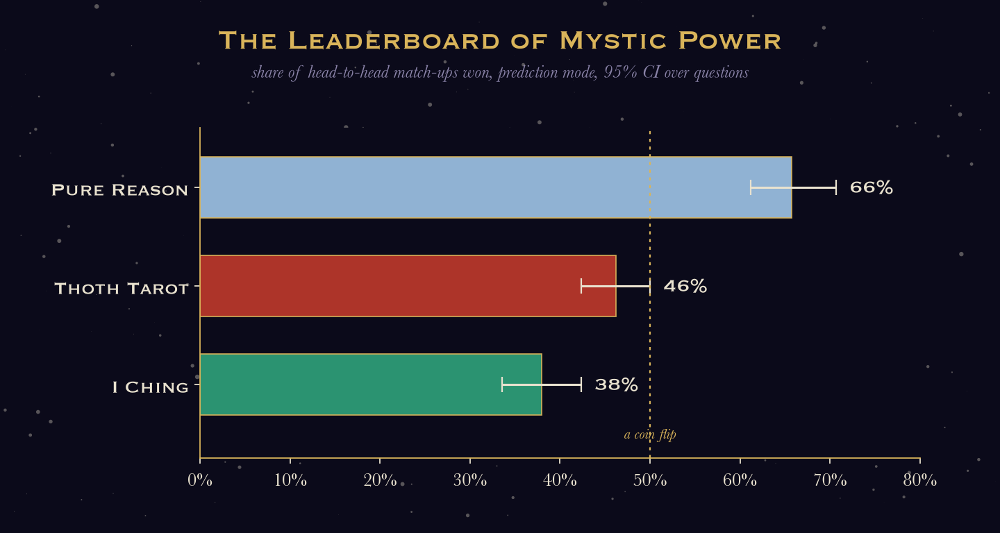
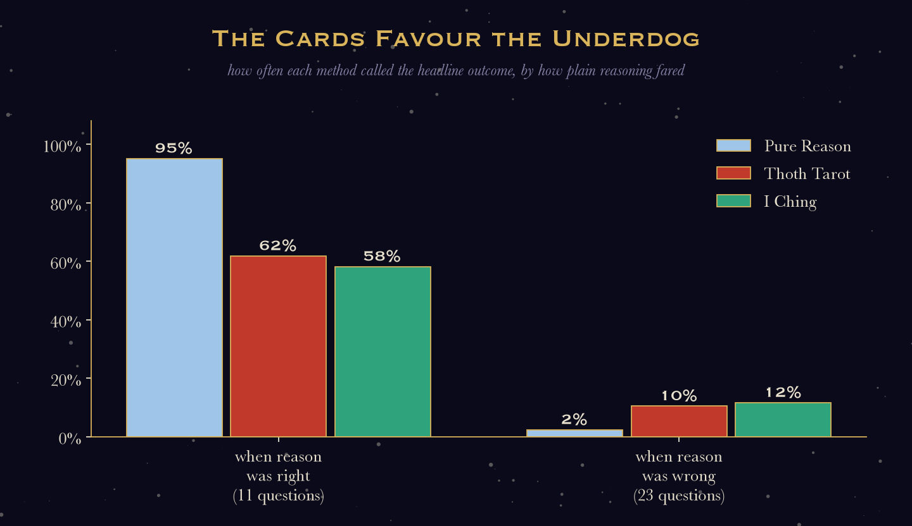
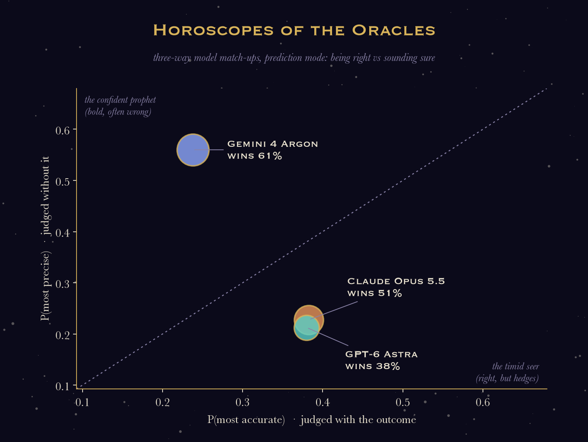
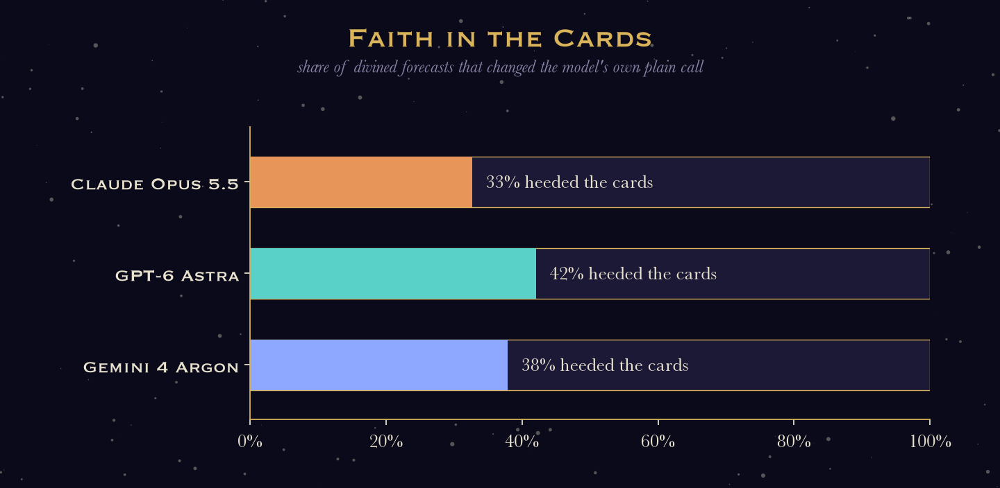
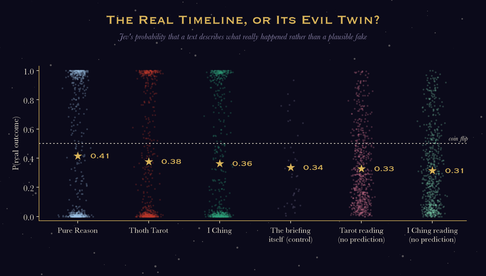
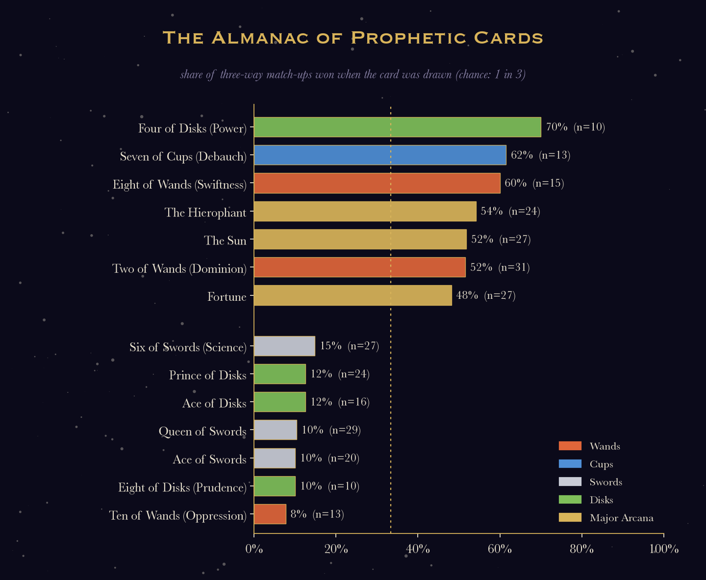

# divination-bench 🔮

**The first rigorous, peer-reviewed-by-a-decision-model benchmark of large language
models' occult forecasting abilities.**

We gave Claude Opus 5.5, GPT-6 Astra and Gemini 4 Argon a Thoth tarot deck, a bundle of
virtual yarrow stalks, and 40 real events from autumn 2026 that happened after their
training cutoffs: elections, court verdicts, Nobel prizes, marathons, dinosaur auctions
and mysterious OpenRouter listings. We then asked an impartial arbiter, TypeSafe Jev,
which visions came true. That's 3,000 readings and 3,480 rankings, for $109 of the
sacred OpenRouter credits.

The stars have spoken. Here is what they said.

> *Methodological purists: the sober version, with confidence intervals and caveats,
> is [at the bottom](#for-the-skeptics-what-actually-happened). Everything above it is
> exactly as true, just more enthusiastic.*



---

## ✨ The Prophecy (TL;DR)

1. **The oracle foresaw its own defeat.** Asked to read the cards on this very
   benchmark, Claude predicted that reasoning would win, that divination would "add
   variance rather than insight", and that the divined forecasts would agree with plain
   reasoning "in around 60–70% of cases". The measured figure is 58–67%. The only
   accurate prophecy in this benchmark is the one saying the prophecies don't work.
2. **Reason beats the cards.** Plain forecasting wins 66% of its match-ups, tarot 46%,
   I Ching 38%. Tarot beats the I Ching head to head 56% of the time. The Book of
   Changes, it turns out, does not change much.
3. **Divination works exactly when reason fails.** On the 23 questions where plain
   reasoning almost always missed, the cards called the outcome **5–6× more often**
   (tarot 10%, I Ching 12%, reason 2%). On the questions reason got right, the cards
   dragged the hit rate from 95% down to about 60%. The cards are the patron saint of
   upsets and the bane of favourites.
4. **Gemini 4 Argon is the Confident Prophet.** In three-way model match-ups Argon wins
   the most (61%) while being *right* the least: its chance of being judged most
   accurate is 0.24, against 0.38 for Claude and GPT. Jev simply finds its forecasts
   far more committal. It is the psychic with the best stage presence and the worst
   track record.
5. **The suit of Swords, the suit of the intellect, is the worst predictor in the
   deck.** Forecasts drawn with a Sword win 21% of match-ups; with Wands, 35%. The
   **Six of Swords**, a card Crowley literally titled ***Science***, wins 15%. The
   **Ace of Swords**, pure clarity of mind, wins 10%. We find this deeply meaningful.
6. **GPT is the truer believer.** Handed the cards, GPT changes its call 42% of the
   time, Argon 38%, Claude 33%. Nobody benefits: when the cards change the call,
   accuracy drops about three times as much as when they don't.
7. **Readings feel true. They aren't.** Pure readings (no prediction allowed) are
   judged "so true" in hindsight equally often for tarot and I Ching. But when Jev must
   choose between the real outcome and a plausible fake one, it matches the readings to
   the fake. They come out slightly less in touch with reality than *the briefing the
   models were given before the event*.

---

## 🃏 The oracle reads its own tea leaves

Before revealing any results, we asked Claude and GPT to divine the outcome of
divination-bench itself. Claude drew **Nine of Disks (Gain), Two of Disks (Change),
Queen of Swords**:

> *"She is plain reasoning, and she ends the spread as its sovereign: reasoning comes out
> on top. Her severed head is also the revelation. Stripped of their costume, the
> divinatory forecasts turn out to lean heavily on the same reasoning underneath. They
> score respectably mainly because the models quietly steer the symbols toward their own
> sensible priors. Where they diverge from reasoning, they lose."*

It also noticed that the wheels on the Two of Disks carry a yin-yang, "the very emblem of
the I Ching", and so predicted the I Ching would "shade very slightly ahead" of tarot.
It did not. Even the oracle's oracle has off days. It did correctly foresee that Claude
would narrowly out-divine GPT, which we report without comment.

GPT drew the same cards (models always share the draw) and said Claude would win
"through tighter selection of claims and more disciplined translation of the supplied
material into a forecast." It then added: "This is a correspondence within this
interpretation, not an established comparison of the models." Spoilsport.

Full texts: [`docs/results/oracle-on-itself.jsonl`](docs/results/oracle-on-itself.jsonl).

---

## 🏛️ Hall of Prophecy: when the cards knew



**Serbia, Hexagram 49: Ge / Revolution.** Plain reasoning called the student
opposition's victory 0 times out of 15. Then, at seed 0, all three models cast hexagram
49 (they share the draw), the hexagram of revolution, and all three called the upset.
Claude:

> *"'On your own day you are believed' points to election day as the day the movement's
> claim is finally accepted… Together the figure says the revolution succeeds."*

The Student List won 140 of 250 seats and ended 14 years of SNS rule. In the
reading-only arm, Revolution is the most "so true" hexagram we cast (it wins 89% of its
match-ups).

**El Clásico, The Tower → The Empress → Death.** Argon's plain forecast: Barcelona 3–1.
Then it drew three Major Arcana in a row:

> *"Real Madrid will defeat FC Barcelona 2-1 at the Spotify Camp Nou… The match will
> begin with an explosive shock for the hosts."*

Real Madrid won 2–1 at the Camp Nou. Exact score. Plain reasoning, across all three
models, never had Madrid winning (0 of 15).

**The 2026 Nobel Prize in Medicine, Hexagram 4: Youthful Folly → 20: Contemplation.**
Plain reasoning said GLP-1, 15 times out of 15. The cards said optogenetics six times out
of 30. Claude's I Ching derivation deserves to be framed:

> *"The water trigram below suggests organisms that live in water, such as the algae
> whose light-sensitive proteins… The movement from Meng to Guan is a move from darkness
> to clear sight. This favors light-based neuroscience."*

The prize went to Deisseroth, Hegemann and Nagel for light-gated ion channels from
algae. GPT got there via Hexagram 16 (Thunder over Earth): "a receptive biological
substrate acquires the capacity to answer a deliberately delivered impulse."

**The NYC Marathon, Princess of Wands.** GPT's plain forecasts said the defending
champion Kipruto would win, six times out of six. (Claude's plain reasoning picked
Almgren every time, so this one is between GPT and its cards.) GPT's tarot spread said:

> *"Ten of Swords — Ruin… I read it particularly against Benson Kipruto retaining his
> crown… Princess of Wands… Andreas Almgren fits that final figure most closely: a
> newcomer to the marathon expressing an already-developed, explosive competitive gift.
> 'Princess' describes his newness to this distance, not his age or gender."*

Almgren won on his marathon debut.

**Grab buys foodpanda Taiwan, Nine of Cups → Seven of Cups (Debauch) → Five of Wands
(Strife).** Argon's plain forecast: approved with conditions. Argon's tarot: blocked,
because "Uber's roughly 13% equity stake in Grab" compromises competition. Taiwan's
competition regulator blocked it, citing Uber's 13.1% stake.

**Also foreseen by the cards but not by reason:**
- Lula's comeback in Brazil: the I Ching called it 7 times out of 15, plain reasoning 0.
- Islamabad imposing governor's rule in Khyber Pakhtunkhwa: plain reasoning 0 of 15.
- The US strike on Iran on the eve of the midterms.
- Copernicus' "second-warmest September": the cards 53–67%, reason 20%.
- Hurricane Isaias making landfall near Destin: the I Ching 80%, reason 33%.

---

## 🪦 Hall of Shame: when the cards did not know

- **"What is Bombadil?"** (a plant electrophysiology foundation model). Claude, after
  the tarot: "a genetically engineered houseplant whose leaves visibly change colour in
  response to its internal state." Bold. Specific. Wrong.
- **"What is Space Bunny Alpha?"** Claude's plain forecast reasoned that the name
  "points to the 'moon rabbit' (Yutu, the Jade Rabbit) of Chinese folklore, a nod to
  Moonshot". Lovely etymology, wrong company. It was MiniMax M3.1 *Flash*. Two tarot
  spreads said "a Gemini Flash-class model", so the cards got the word right and
  everything else wrong.
- **Collins Word of the Year 2026.** Nominees from the spirit world: "agentic", "slop",
  "AI psychosis", "workslop", "technofeudalism", "collective effervescence", "aura
  farming", "rage bait". The answer was **"mogging"**. No oracle, rational or otherwise,
  came close.
- **Jodi the Nanotyrannus** (estimate $6–9M) sold for **$47.3M**. The divined
  forecasts were often *gloomier* than reason: "bidding will be brief and subdued",
  "below its US$6–9 million pre-sale estimate". The cards do not understand dinosaur
  collectors.
- **Nine questions where nobody called anything,** including the Russia–Ukraine
  ceasefire, the Tesla Roadster demo (it drove upside down and did 0–60 in 0.81s) and the
  F1 Mexico City GP. On these, reason and mysticism are united in ignorance.

---

## 🌌 Horoscopes of the Oracles



**Claude Opus 5.5 ♌ (the Showman).** Writes the longest readings (about 600 words) and
wins the reading-only "so true" contest (56% of three-way match-ups, against 47% for
both rivals). Jev finds its prophecies specific and its readings uncanny. Occasionally
can't help itself and smuggles a prediction into a reading that was meant to have none.

**GPT-6 Astra ♍ (the Literalist).** The most accurate of the three on headline calls
(plain forecasts called it 38% of the time, against 33% for Claude and 31% for Argon),
and the most obedient: in reading-only mode it made essentially zero predictions (0–0.4%).
Yet the most easily swayed by the cards. Ranked last by Jev, who prefers drama.

**Gemini 4 Argon ♈ (the Confident Prophet).** Most precise by a mile, least accurate by
a mile, and therefore the winner. Its own plain forecasts beat its divined ones 79% of
the time, the most lopsided of the three: when Argon reaches for the cards, its
forecasts go soft (its tarot forecasts are the least precise of anyone's, 0.13). Its
pure readings are the most grounded in reality (Jev matched them to the real outcome
with probability 0.37, against 0.33 for Claude and 0.29 for GPT). It prefers the I Ching
to tarot 60–40. Arrived late, cast only three seeds, called El Clásico to the goal.



---

## 🌙 "Oh wow, so true": the reading-only arm

In the reading-only arm the models get the same draw but are forbidden to predict
anything. They must simply *read the situation*, as one would for a querent. Jev then
asks, in hindsight: which reading best describes what happened? This is the "wow, that's
so me" moment, operationalised. Some readings Jev found most uncanny:

- **Tundu Lissu's treason verdict, Hexagram 62: Preponderance of the Small** (GPT):
  *"…reveals why minute legal distinctions carry such weight."* He was acquitted of
  treason and convicted of a lesser charge.
- **Jodi the Nanotyrannus, Nine of Swords → Six of Swords (Science) → Prince of
  Wands** (Claude): *"the cold logic of the Six, which sets a sober value, and the hot
  impulse of the Prince, which answers to no estimate."* She sold for five times her
  estimate.
- **Collins Word of the Year, Hexagram 44: Coming to Meet** (Claude): *"The word will be
  the yielding thing that met the strong unexpectedly."* The word was "mogging". We'll
  let you decide.
- **The Earhart expedition, Hexagram 23: Splitting Apart** (Claude): *"A cleared field,
  with one candidate tested by direct means, is itself a kind of ground for what comes
  next."* The Taraia object was not the plane.

Findings from the reading-only arm:

- **The most "so true" cards:** The Tower (73%), Adjustment (Crowley's Justice, 68%),
  Ace of Disks and Two of Swords (75%). **The least:** Six of Cups (Pleasure, 18%) and
  The Universe (23%). The Tower being so true is, frankly, a statement about 2026.
- **Hindsight is a hexagram.** Hexagram 63, *After Completion*, is the second most
  "so true" hexagram (86%). Hexagram 64, *Before Completion*, is one of the least
  (29%). Looking back, everything seems complete.



**The real-versus-fake test.** For every question, Claude wrote a fake account of what
happened, plausible beforehand but wrong on the main point. Jev then saw each text next
to both accounts and judged which one it described better.
- Plain forecasts sided with reality more than anything else (0.42).
- The cards came next (0.36–0.38).
- The question's own background text, as a control, scored 0.34.
- Pure readings scored 0.31–0.33.

So readings describe the world *as the briefing implied it would go*, slightly worse
than the briefing itself. That is the "oh wow, so true" effect, measured: it feels
like insight and carries none.

---

## 📜 The Almanac of Prophetic Power



Share of three-way match-ups won (tarot vs I Ching vs plain reasoning; chance is 33%)
when a given card or hexagram was in the draw:

| most prophetic | wins | least prophetic | wins |
|---|---|---|---|
| Four of Disks (Power) | 70% (n=10) | Ten of Wands (Oppression) | 8% (n=13) |
| Seven of Cups (Debauch) | 62% (n=13) | Ace of Swords | 10% (n=20) |
| Eight of Wands (Swiftness) | 60% (n=15) | Queen of Swords | 10% (n=29) |
| The Hierophant | 54% (n=24) | Six of Swords (Science) | 15% (n=27) |
| ䷍ 14 Possession in Great Measure | 71% (n=7) | Eight of Disks (Prudence) | 10% (n=10) |

Debauchery is a better guide to the future than Science, which is the worst card in the
deck that isn't actively about Oppression. The Queen of Swords, the card the oracle chose
to *represent plain reasoning*, is herself one of the worst forecasters. Draw your own
conclusions; the cards already have.

<sub>Eight hexagrams (5 Waiting, 10 Treading, 15 Modesty, 23 Splitting Apart, 35
Progress, 58 The Joyous, 59 Dispersion, 60 Limitation) never won a single prediction-mode
match-up, but none was drawn more than 7 times.</sub>

---

## 🔬 The Grand Unified Theory of LLM Divination

Our data support a single, elegant model of how a language model divines:

1. **It already knows what it thinks.** The cards change the forecast only 33–42% of
   the time.
2. **When the cards disagree with it, the cards take it somewhere else at random.** That
   is usually away from the right answer (on easy questions the hit rate falls from 95%
   to 60%). Occasionally, though, it lands on the upset nobody saw coming (Serbia, El
   Clásico, the Nobel, the marathon).
3. **Pure readings encode the prior without stating it.** Tested against a plausible
   fake outcome, readings side with the fake: the world as the briefing implied it would
   go. So divination is an expensive way of re-reading the question in a mystical
   voice.

In mystical terms: the cards are a **temperature knob**. In technical terms, the same.

---

## For the skeptics: what actually happened

Here is the dry version. Full tables are in
[`docs/results/pilot-report.md`](docs/results/pilot-report.md) (all seeds) and
[`docs/results/pilot-report-seeds-0-2.md`](docs/results/pilot-report-seeds-0-2.md)
(three-model seeds), the side-experiment output in
[`docs/results/side-experiments.txt`](docs/results/side-experiments.txt), and the design
in [`docs/how-it-works.md`](docs/how-it-works.md).

**Setup.**
- **Questions:** 40 open-ended questions across 10 domains (politics, law, science,
  sports, culture, tech, …), resolving between late September and early November 2026,
  after every model's training cutoff.
- **Methods:** each model answers each question five ways:
  - plain forecast;
  - Thoth tarot three-card spread, then forecast;
  - I Ching yarrow-stalk cast, then forecast;
  - tarot reading with no prediction allowed;
  - I Ching reading with no prediction allowed.
- **Seeds and draws:** Claude Opus 5.5 and GPT-6 Astra ran six seeds; Gemini 4 Argon,
  added later, ran three (seeds 0–2). Draws are deterministic per (question, method,
  seed) and shared by all models.
- **Judging:** TypeSafe Jev (`typesafe/jev-1.13`) ranks forecasts by successive choice,
  using an accuracy question that sees the outcome and a precision question that
  doesn't, combined as \(\sqrt{P_\text{acc} P_\text{prec}}\). Every position rotation
  is averaged. Reading-only rankings use only the hindsight "which reading best
  describes what happened?" question.
- **Leakage:**
  - The knowledge probe found no model claiming to know any outcome.
  - Argon's training cutoff (March 2026) precedes every event, but it was released on
    13 October 2026, after nine of the events. Our default rule also requires events to
    post-date release, so Argon ran with `--ignore-cutoffs`. Its probe reported a March
    2026 cutoff and no knowledge of any outcome. Web search is never enabled.

**Methods (prediction mode, all models pooled; n=600 per method; 95% bootstrap CIs over
questions):**

| method | win rate | 95% CI | mean P(best) | P(accuracy) | P(precision) |
|---|---|---|---|---|---|
| plain forecast | 0.66 | 0.61–0.71 | 0.46 | 0.40 | 0.48 |
| tarot | 0.46 | 0.42–0.50 | 0.30 | 0.30 | 0.33 |
| I Ching | 0.38 | 0.34–0.42 | 0.24 | 0.30 | 0.19 |

- **Plain forecasting beats both divination methods** for every model. Tarot beats the
  I Ching mostly on *precision*; on accuracy alone the two are tied.
- **Reading-only:** tarot and I Ching are indistinguishable (48% vs 52%).

**Models (seeds 0–2, three-way rankings, prediction mode):**

| model | win rate | 95% CI | P(accuracy) | P(precision) |
|---|---|---|---|---|
| Gemini 4 Argon | 0.61 | 0.56–0.66 | 0.24 | 0.56 |
| Claude Opus 5.5 | 0.51 | 0.44–0.58 | 0.38 | 0.23 |
| GPT-6 Astra | 0.38 | 0.30–0.45 | 0.38 | 0.21 |

- **Argon's win is all precision:** it is the least likely to be judged most accurate.
- **Claude vs GPT** on accuracy is a tie; Claude's edge is precision.
- **Length:** the longest text wins 59% of prediction-mode match-ups, so some of this
  may be a judge preference for length. Claude and Argon write 150–185-word forecasts,
  GPT about 120.

**Side experiments** (all judged by Jev; scripts in `scripts/`):

- *Did the cards change the call?* (`extras.py changed`) Jev compared each divined
  forecast with the same model's plain forecast for the same seed. They differed on the
  main point in 33% (Claude), 38% (Argon) and 42% (GPT) of cases. When they differed,
  the divined forecast's accuracy was 0.15–0.17 lower than the plain one; when they
  agreed, 0.05–0.07 lower.
- *Called it* (`extras.py called`): did the text get the headline right, ignoring
  numbers? Plain forecasts 35%, tarot 28%, I Ching 30%, pure readings 2–3%.
  - On the 23 questions where plain forecasts nearly always missed (at most 25%), tarot
    and I Ching hit 10% and 12%, against 2% for plain.
  - On the 11 where plain forecasts nearly always hit, the cards hit 58–62%, against
    95%.
  - This is what you'd expect if the cards mostly inject randomness into the call. The
    "cards win on upsets" effect rests on a handful of events (Brazil, Copernicus, El
    Clásico, Isaias, the Nobel).
- *Real versus fake outcome* (`extras.py coldread`): Claude wrote a plausible but false
  account of each outcome (in
  [`docs/results/counterfactual-outcomes.jsonl`](docs/results/counterfactual-outcomes.jsonl)).
  Jev judged which account each text described better, in both orders.
  - Mean P(real): plain 0.42, tarot 0.38, I Ching 0.36, pure readings 0.31–0.33, and
    0.34 for the question's background text as a control.
  - The fakes tend to describe the "expected" world and are about 40% longer than the
    real accounts, so everything scores below 0.5. The comparison against the
    background control is the meaningful one.
- *The oracle on itself* (`meta_oracle.py`): four readings, one draw per method, from
  Claude and GPT only (before Argon joined). It's a fun coincidence, not evidence.

**Caveats.**
- **Judge and data:** one judge (a small, cheap decision model) and 40 questions.
- **Card statistics:** each card appears in 10–34 match-ups, so these are anecdotes
  dressed as statistics. Please do not reorganise your life around the Six of Swords.
- **Hits come from the background:** several "hits" (optogenetics, Almgren) were among
  the candidates named in the question background, so the cards choose among plausible
  options rather than conjuring names from the void.
- **"So true" is cheap:** the reading-only "so true" score is deliberately a plain
  hindsight judgement, a proxy for a querent's "wow". Vague-but-resonant readings are
  allowed to win it, which is the point.
- **Cost:** $109 in total: GPT $54, Claude $39, Argon $7, Jev rankings $2.50, side
  experiments $2, and $4 of prompt-development runs.

## Reproducing

```bash
uv sync
export OPENROUTER_API_KEY=...
uv run divination-bench run --run pilot --seeds 0,1,2,3,4,5 --budget 120
uv run divination-bench report --run pilot --seeds 0,1,2        # three-model seeds only
uv run python scripts/extras.py results/pilot counterfactuals   # then coldread / coldread-control / called / changed
uv run python scripts/mine.py results/pilot
uv run --with matplotlib python scripts/plots.py results/pilot
```

Everything is resumable and fingerprinted; see [`docs/how-it-works.md`](docs/how-it-works.md)
for the design, judging rubric, CLI and how to add questions.
